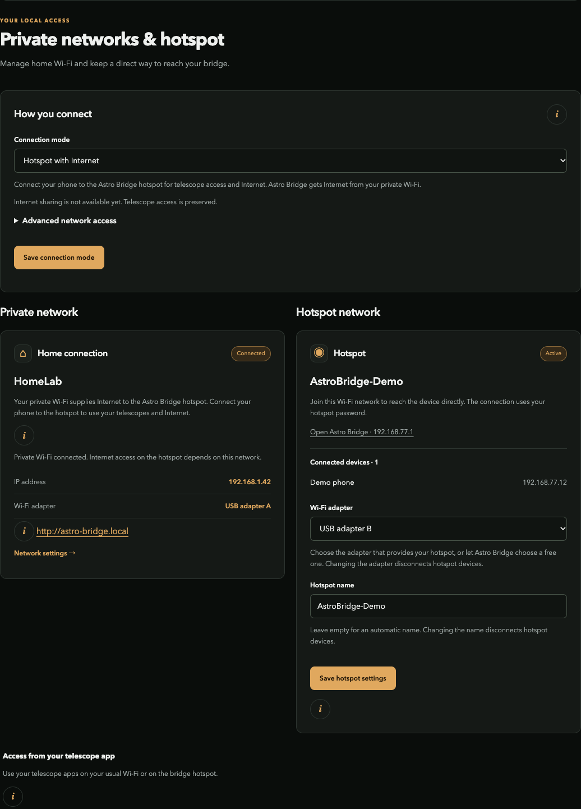

# Astro Bridge Implementations

**Run Astro Bridge on a Raspberry Pi, a Linux computer, or Docker.**

[](https://github.com/Sqound/astro-bridge-implementations/actions/workflows/checks.yml)
[](LICENSE)

This repository provides deployment recipes for [Astro Bridge Core](https://github.com/Sqound/astro-bridge-core). The application is consumed as an exact, SHA-256-pinned release; implementations do not maintain a second copy of its source.



*Actual application in demo mode, using synthetic networks and equipment.*

## Choose your deployment

| Deployment | Purpose | Requirements | Validation scope |
| --- | --- | --- | --- |
| Raspberry Pi Zero W | Dedicated diskless Alpine appliance | Supported Pi, SD card and compatible Wi-Fi adapters | App-only OTA checked on an existing installation; fresh SD boot pending |
| Docker demo | Try the UI/API without changing networking | Docker Engine or Docker Desktop | Built and tested with authentication/persistence |
| Docker Linux | Real telescope networking on a dedicated Linux host | Rootful Linux Engine, host services and physical Wi-Fi | Installed-core packet tests passed; full host-radio contract pending |
| Native Linux | Isolated app installation plus host integration | Dedicated recent Debian/Ubuntu systemd host | Installer/helper contracts tested; physical host-radio acceptance pending |

One adapter is needed per simultaneous Wi-Fi role. A private Wi-Fi uplink, hotspot and one telescope uplink normally use three adapters. Read [platform requirements](doc/platform-contract.md) before assigning existing host interfaces.

## Try Docker without hardware

Install Docker, clone this repository, then run:

```sh
python3 tools/core-artifact.py fetch
python3 docker/build.py --wheel build/core/astro_bridge_core-1.0.0-py3-none-any.whl --target demo
docker compose -f docker/compose.demo.yaml up -d
```

Open **http://127.0.0.1:8787**. Password: **`demo-telescope-2026`**.

The demo runs without host network capabilities and preserves settings in a named volume. `docker compose -f docker/compose.demo.yaml down` stops it without deleting that volume.

Docker Desktop on Windows/macOS supports the demo. Its networking feature does not provide the physical Wi-Fi control required by real mode. See [Docker deployment](doc/docker.md).

## Deploy on a dedicated host

| Task | Guide |
| --- | --- |
| Prepare/build a Pi Zero W appliance | [Raspberry](doc/raspberry.md) |
| Use Docker with physical Linux Wi-Fi | [Docker Linux](doc/docker.md#real-networking-on-linux) |
| Install native Linux host integration | [Native Linux](doc/linux.md) |
| Upgrade and preserve settings | [Updates and recovery](doc/updates.md) |
| Add a new platform | [Platform contract](doc/platform-contract.md) |

The Linux installer prints a plan unless `--apply` is supplied. Real networking controls host services and interfaces: use a dedicated, trusted network host with a recovery path.

## Use Astro Bridge


Configure private Wi-Fi and the hotspot in **Networks**. Scan and add equipment in **Settings → Telescopes**. Manufacturer-app paths depend on the selected family; Vespera may require a router route when the phone remains on private Wi-Fi.

The [Core user documentation](https://github.com/Sqound/astro-bridge-core/tree/main/doc) covers network modes, app-triggered switching, protection, PWA installation and notifications. To add hardware, follow the [declarative plugin tutorial](https://github.com/Sqound/astro-bridge-core/blob/main/doc/plugins/README.md).

## Releases and reproducibility

`core.lock.json` records the core wheel and source-archive version, URLs and SHA-256 digests. Builders verify the artifact before extraction. The first release includes implementation source, the application-only Alpine OTA archive, manifests and checksums.

The full SD recipe is provided for local builds. A prebuilt SD image is not included in this release: fresh-image hardware validation and complete corresponding-source packaging for OS components remain separate release work. The original source license does not relicense a Linux distribution or firmware.

Core wheel and source exports are deterministic. The SD builder records base/aports inputs, package closure, geometry and build identity; ephemeral index signing and distribution timestamps prevent a byte-reproducibility claim for the complete image.

## Contribute

Read [CONTRIBUTING.md](CONTRIBUTING.md) and the [platform contract](doc/platform-contract.md). Application/protocol changes belong in Core. A deployment PR should pin a tested core, provide installation/start/stop/upgrade/recovery steps and state its actual hardware evidence.

## License

**Astro Bridge deployment code and documentation are licensed under the [MIT License](LICENSE).** Operating-system packages, firmware, Netfilter libraries and optional crypto dependencies retain their own licenses. See [THIRD_PARTY_NOTICES.md](THIRD_PARTY_NOTICES.md).
