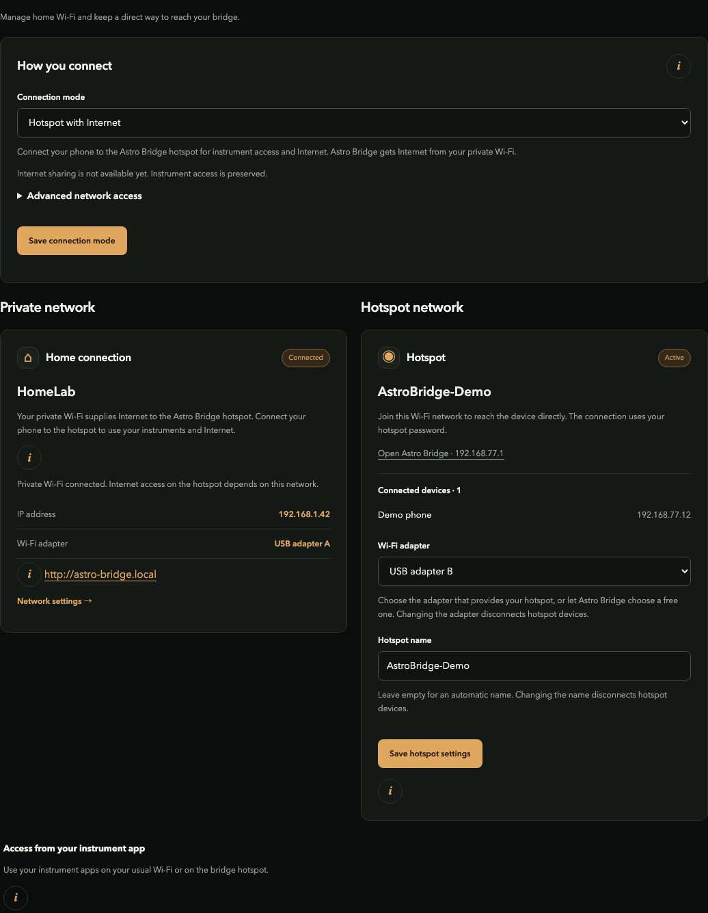
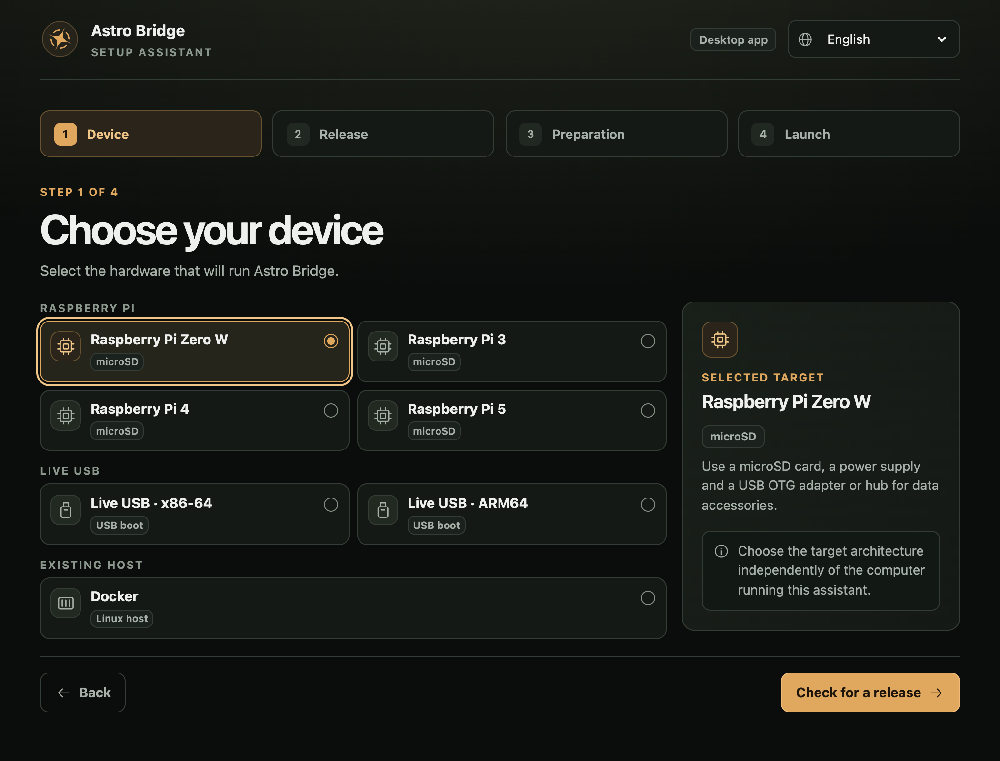
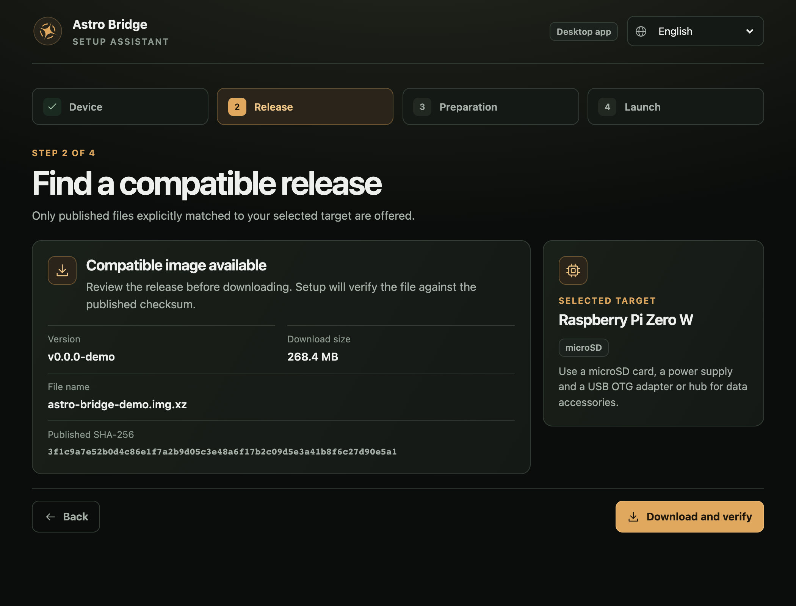
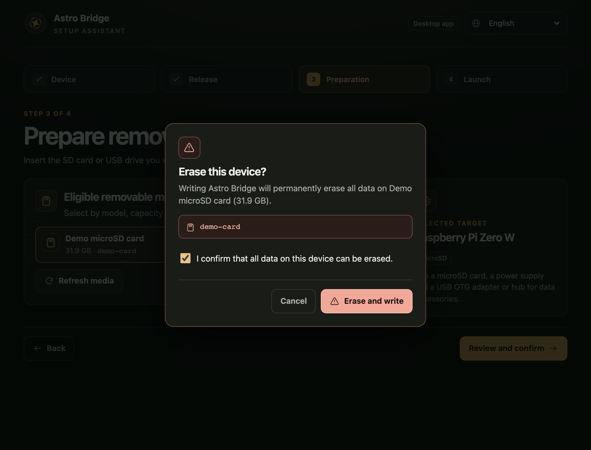
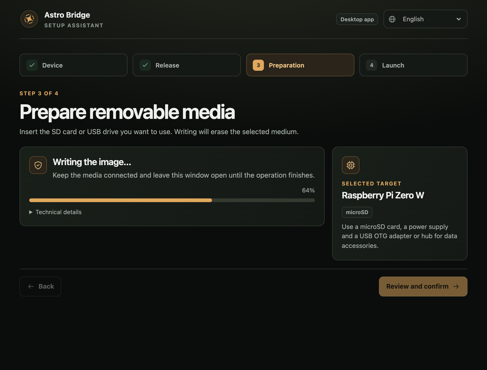
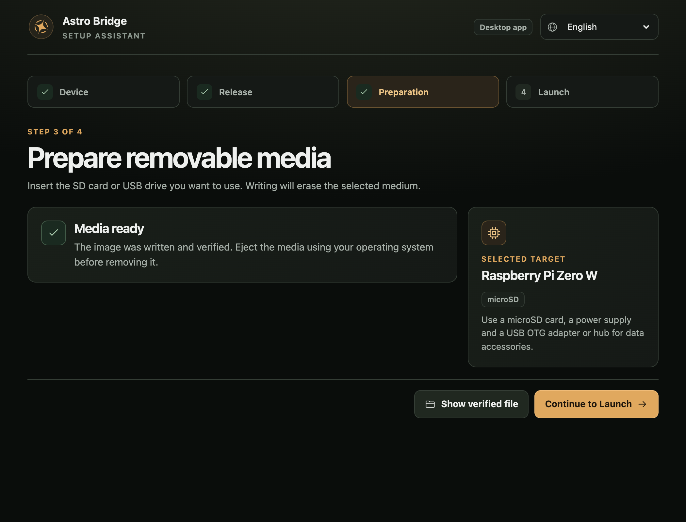
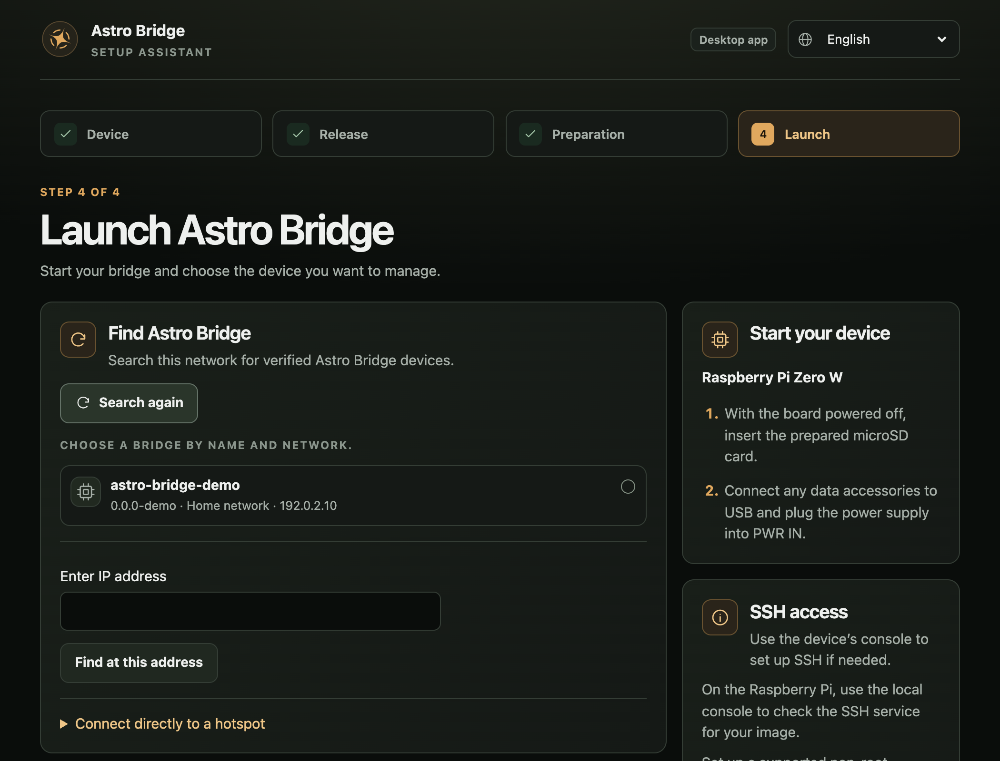
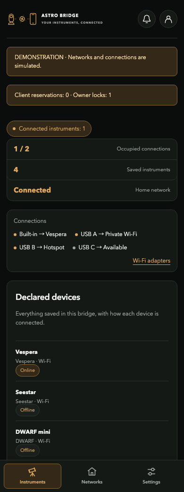

# Astro Bridge Implementations

**Run Astro Bridge on a Raspberry Pi, a Linux computer, or Docker.**

Astro Bridge Implementations is part of [PlanAstro](https://www.planastro.space/), a complete astrophotography solution: plan your night, drive your telescope and mount from your smartphone, assisted by its own plate solving, then process and share your images.

[](https://github.com/Sqound/astro-bridge-implementations/actions/workflows/checks.yml)
[](LICENSE)

This repository provides deployment recipes for [Astro Bridge Core](https://github.com/Sqound/astro-bridge-core). The application is consumed as an exact, SHA-256-pinned release; implementations do not maintain a second copy of its source.



*Actual application in demo mode, using synthetic networks and equipment.*

## Choose your deployment

All three options run the same application:

| Option | Included | Installation |
| --- | --- | --- |
| **Complete Raspberry Pi image** | Alpine Linux, Astro Bridge, drivers and system services | Flash an SD card for the original Raspberry Pi Zero W; Astro Bridge starts automatically at boot |
| **Core only** | The application, web interface, API and hardware plugins | Install on an existing system; real Wi-Fi control also needs Linux host integration |
| **Docker** | Core and its container dependencies | Run on an existing Docker host: demo on macOS/Windows, or real networking on a compatible Linux host |

The Raspberry download is a complete operating-system image. Core and Docker install the application on a computer that already has an operating system. See [installation options](doc/deployment-options.md) for the differences, or the [validation matrix](doc/reference/validation.md) for hardware evidence.

One adapter is needed per simultaneous Wi-Fi role. A private Wi-Fi uplink, hotspot and one telescope uplink normally use three adapters. Read [platform requirements](doc/platform-contract.md) before assigning existing host interfaces.

## Download ready-to-use files

Use the [latest release](https://github.com/Sqound/astro-bridge-implementations/releases/latest) (1.1.0). The simplest way to prepare a card is **Astro Bridge Setup** (below): it picks the right image for your board, verifies it and writes it.

| Goal | Download |
| --- | --- |
| Prepare a card or a Docker host step by step | Astro Bridge Setup: `Astro-Bridge-Setup_macos_arm64.dmg`, `Astro-Bridge-Setup_windows_x64-setup.exe`, `Astro-Bridge-Setup_linux_x64.deb` or `.AppImage` |
| Complete Raspberry Pi Zero W system | `astro-bridge-1.1.0-alpine-armhf-standard.img.xz` (Setup, the [native flasher](doc/flasher.md) or Raspberry Pi Imager) |
| Complete Raspberry Pi 5 system | `astro-bridge-1.1.0-alpine-aarch64-pi5.img.xz` (Setup or Raspberry Pi Imager) |
| Deploy Docker on a Linux PC | `install-docker.sh`; plans first, installs dependencies and starts the chosen deployment with `--apply` |
| Run the Docker demo on macOS/Windows | `install-docker.py`; Docker Desktop setup may require a first-run action or OS reboot |
| Update an existing compatible appliance | Alpine armhf application-only OTA and its manifest |

Verify downloaded files with the release's `SHA256SUMS`. The [Raspberry guide](doc/raspberry.md) and [Docker installer guide](doc/docker.md) give the exact steps.

## Astro Bridge Setup

Astro Bridge Setup is a desktop assistant (Tauri 2) in [`setup/`](setup/README.md). It guides you through four steps:

1. **Device:** choose a Raspberry Pi, a live USB architecture or a Docker host.
2. **Release:** find a published file that explicitly lists that target; download it over HTTPS and verify its size and SHA-256.
3. **Preparation:** confirm the erase, then write and read back the SD card or USB drive with the pinned Raspberry Pi Imager engine; for Docker, keep the verified installer.
4. **Launch:** start the device, discover the bridge on the local network (or enter its IPv4 address) and open its web interface.

| Choose the device | Verify the release | Confirm the erase |
| --- | --- | --- |
|  |  |  |

| Write and read back | Media ready | Find the bridge |
| --- | --- | --- |
|  |  |  |

*Actual Setup interface with a synthetic backend: release, card and bridge names are demonstration values.*

**Install:** from the [latest release](https://github.com/Sqound/astro-bridge-implementations/releases/latest), download `Astro-Bridge-Setup_macos_arm64.dmg` (signed and notarized), `Astro-Bridge-Setup_windows_x64-setup.exe` or `Astro-Bridge-Setup_linux_x64.deb` / `.AppImage` (not signed), and check it against `SHA256SUMS`. Setup has the same version as the release. **Run:** open *Astro Bridge Setup*, select **Get started**, and follow the steps; select **Find a running bridge** to manage a bridge that is already running. With release 1.1.0 Setup writes the Raspberry Pi Zero W and Raspberry Pi 5 images and fetches the Docker installer; Pi 3, Pi 4 and live USB show "No compatible release available" until a release lists them. Full instructions, build commands and limits: [setup/README.md](setup/README.md).

## What has been verified

| Family | Implemented | Tested in simulation | Verified on hardware |
| --- | --- | --- | --- |
| Raspberry Pi 5 host, hotspot, two USB Wi-Fi adapters | Yes (image in implementations 1.1.0) | Yes | **Yes, partly:** automatic adapter roles in under 6 s, IPv4 forwarding, hotspot DHCP, DNS and Internet, Setup Launch found the bridge. Offline fallback hotspot not yet checked |
| Raspberry Pi Zero W host | Yes (image in implementations 1.1.0) | Yes | **Partly:** 600 s idle run and a TCP relay test (147/147 replies). Camera hosting is not supported on this board. A full telescope session, hotspot loss/recovery and phone discovery are not yet checked |
| Raspberry Pi 3 B, Pi 4 | Yes | Yes | No |
| Vespera (Wi-Fi, routed original address) | Yes | Yes | **Partly:** switching and the manufacturer-app path. Two isolated Vespera, per-tab switching and night reservation: no |
| Seestar (relays, station profile) | Yes | Yes | **Partly:** automatic switching to and from another telescope (about 40 s) with notifications. Bridge `scan_iscope` probe and station mode: no |
| DWARF (relays, operation state) | Yes | Yes | **Partly:** manufacturer-app discovery observed. Operation-state reading during a capture: no |
| ZWO Wi-Fi mounts (TCP 4030) | Yes (read-only identification, relay, protection) | Yes | **Partly:** model read through the relay. Control, guiding, automatic switching: no |
| SynScan Wi-Fi mounts (UDP 11880) | Yes | Yes | No |
| Celestron NexStar over USB serial (TCP relay) | Yes | Pseudo-terminal tests | No |
| USB cameras over Alpaca (ZWO ASI) | Yes | Yes | **Partly:** ASI220MM, two 0.2 s exposures, 16-bit FITS (1920 × 1080 direct, 640 × 480 through a hub); full frame through a hub failed with USB resets |
| USB cameras (UVC, gPhoto) | Yes | Yes | No |
| Native client contract 1.2 (pairing, leases, events, telemetry) | Yes | Replay scenarios and loopback mock | No third-party client verified against a physical bridge |
| Astro Bridge Setup 1.1.0 (macOS, Windows, Linux) | Yes | Unit, Rust and browser tests with mocks | **Partly:** Launch found a Pi 5 bridge on a private network (macOS). Writing a card from the published 1.1.0 images: not yet checked; Windows and Linux builds not checked on a computer |
| Docker demo | Yes | Yes | Demo verified in a Linux VM on macOS. Physical USB Wi-Fi inside Docker: no |

**Documented is not verified.** Only the last column is hardware evidence; "partly" lists exactly what was observed. A matching Wi-Fi name is a hint, not proof of compatibility. Live USB images and Celestron Origin are not part of this release. A freshly written 1.1.0 image still needs its first-boot check on each board.

Per-release detail: [validation matrix](doc/reference/validation.md).

## Try Docker without hardware

Install Docker, clone this repository, then run:

```sh
python3 tools/core-artifact.py fetch
python3 docker/build.py --wheel build/core/astro_bridge_core-1.1.0-py3-none-any.whl --target demo
docker compose -f docker/compose.demo.yaml up -d
```

Open **http://127.0.0.1:8787**. Password: **`12345678`**.

New Raspberry, native Linux and Docker installations also use **`12345678`** for web access and the hotspot. Existing installations retain their saved passwords during upgrades.

The demo runs without host network capabilities and preserves settings in a named volume. `docker compose -f docker/compose.demo.yaml down` stops it without deleting that volume.

Standard Docker Desktop setups on Windows/macOS support the demo. Physical Wi-Fi control additionally requires adapters and host services inside the Linux VM; USB forwarding is not configured or validated by this installer. See [Docker deployment](doc/docker.md).

## Deploy on a dedicated host

| Task | Guide |
| --- | --- |
| Prepare/build a Pi Zero W appliance | [Raspberry](doc/raspberry.md) |
| Use Docker with physical Linux Wi-Fi | [Docker Linux](doc/docker.md#real-networking-on-linux) |
| Install native Linux host integration | [Native Linux](doc/linux.md) |
| Upgrade and preserve settings | [Updates and recovery](doc/updates.md) |
| Add a new platform | [Platform contract](doc/platform-contract.md) |

The Linux installer prints a plan unless `--apply` is supplied. Real networking controls host services and interfaces: use a dedicated, trusted network host with a recovery path.

## Use Astro Bridge



Configure private Wi-Fi and the hotspot in **Networks**. Scan and add equipment in **Settings → Telescopes**. Manufacturer-app paths depend on the selected family; Vespera may require a router route when the phone remains on private Wi-Fi.

The [Core user documentation](https://github.com/Sqound/astro-bridge-core/tree/main/doc) covers network modes, app-triggered switching, protection, PWA installation and notifications. To add hardware, follow the [declarative plugin tutorial](https://github.com/Sqound/astro-bridge-core/blob/main/doc/plugins/README.md).

## Releases and reproducibility

`core.lock.json` records the core wheel and source-archive version, URLs and SHA-256 digests. Builders verify the artifact before extraction. Releases include implementation source, Astro Bridge Setup for macOS, Windows and Linux, the Raspberry Pi Zero W and Raspberry Pi 5 SD images with `astro-bridge-setup-manifest.json`, the application-only Alpine OTA, Docker installers, manifests and checksums. Unsigned Windows and Linux files and the images are built by the manual `release-builds.yml` workflow; the macOS Setup is signed and notarized by a maintainer.

The SD image is accompanied by exact signed-package recipe revisions and checksum-verified upstream source archives. Image structure, package signatures and application identity are checked during construction. A freshly flashed physical board remains a separate acceptance step. OS packages and firmware retain their own licenses.

Core wheel and source exports are deterministic. The SD builder records base/aports inputs, package closure, geometry and build identity; ephemeral index signing and distribution timestamps prevent a byte-reproducibility claim for the complete image.

## Contribute

Read [CONTRIBUTING.md](CONTRIBUTING.md) and the [platform contract](doc/platform-contract.md). Application/protocol changes belong in Core. A deployment PR should pin a tested core, provide installation/start/stop/upgrade/recovery steps and state its actual hardware evidence.

## License

**Astro Bridge deployment code and documentation are licensed under the [MIT License](LICENSE).** Operating-system packages, firmware, Netfilter libraries and optional crypto dependencies retain their own licenses. See [THIRD_PARTY_NOTICES.md](THIRD_PARTY_NOTICES.md).
