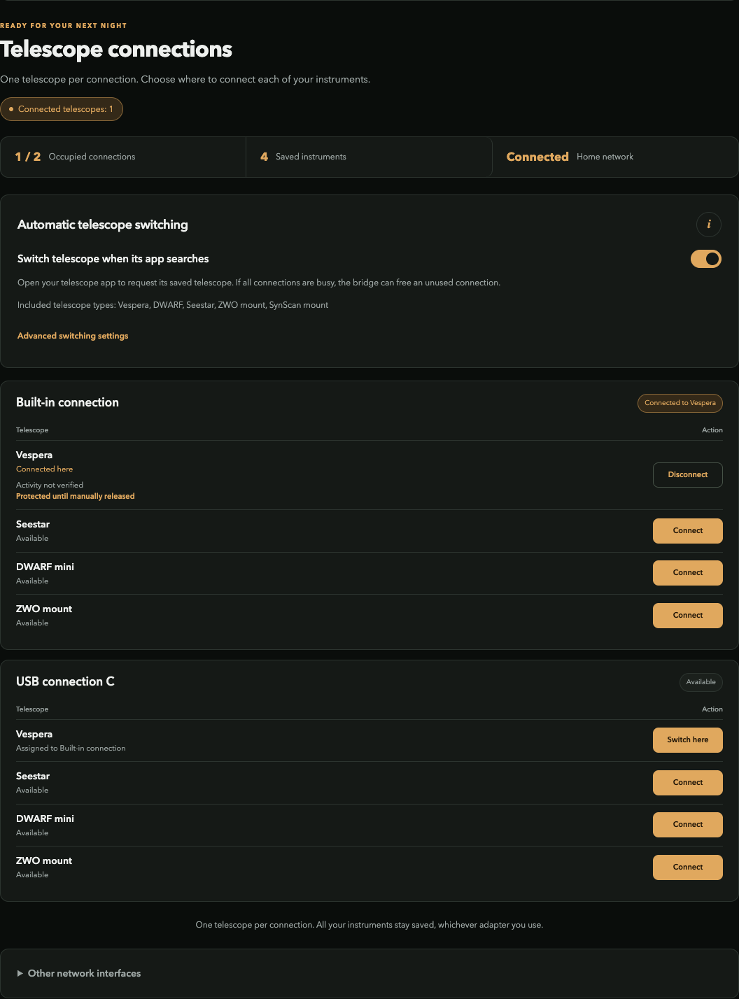

# Docker deployment

[Documentation](README.md) / Docker

## Try the demo

```sh
python3 tools/core-artifact.py fetch
python3 docker/build.py --wheel build/core/astro_bridge_core-1.0.0-py3-none-any.whl --target demo
docker compose -f docker/compose.demo.yaml up -d
```

Open **http://127.0.0.1:8787** and use **`demo-telescope-2026`**. This mode works with Docker Engine or Docker Desktop and does not control radios.



| Operation | Command |
| --- | --- |
| Stop, retain configuration | `docker compose -f docker/compose.demo.yaml down` |
| View logs | `docker compose -f docker/compose.demo.yaml logs` |
| Remove demo state | Add `--volumes` to `down` only when a reset is intended |

## Real networking on Linux

Use a **dedicated rootful Linux Docker Engine host** with systemd, NetworkManager and suitable physical Wi-Fi adapters.

```sh
# Inspect the host changes first.
sudo python3 linux/host-install.py --mode docker
sudo python3 linux/host-install.py --mode docker --apply
python3 docker/build.py --wheel build/core/astro_bridge_core-1.0.0-py3-none-any.whl --target linux
docker compose -f docker/compose.linux.yaml up -d
```

Read the initial random access code locally with `sudo cat /etc/wifi-bridge/bootstrap.json`. Open the host's configured management IP, localhost, or **192.168.77.1** after joining the hotspot.

## Host access contract

| Access | Reason |
| --- | --- |
| Host network namespace | Routing, broadcast reception and radio interfaces |
| Host PID namespace | Identify the actual NetworkManager process for observation coverage |
| D-Bus/systemd sockets | Host NetworkManager and app-owned AP/DHCP services |
| NM connection/state mounts | Host services and container share generated profiles/configuration |
| `/dev/rfkill`, NET_ADMIN, NET_RAW | Radio and network operations |

These service sockets confer powerful host control. This is a trusted dedicated-host integration, not a sandbox for untrusted code. No Docker daemon socket is mounted. Rootless Docker and Docker Desktop do not supply this radio contract.

The container does not start a second NetworkManager daemon. Its entrypoint checks required host integration, forwards termination and cleans up app-owned AP/DHCP services and its main nft table. Persistent credentials stay in host directories.

The final image carries recent nftables and private-prefix, source-verified conntrack 1.4.9/libnetfilter_conntrack 1.1.1. The complete packet suites pass in isolated containers; physical host/radio integration remains a separate check.
