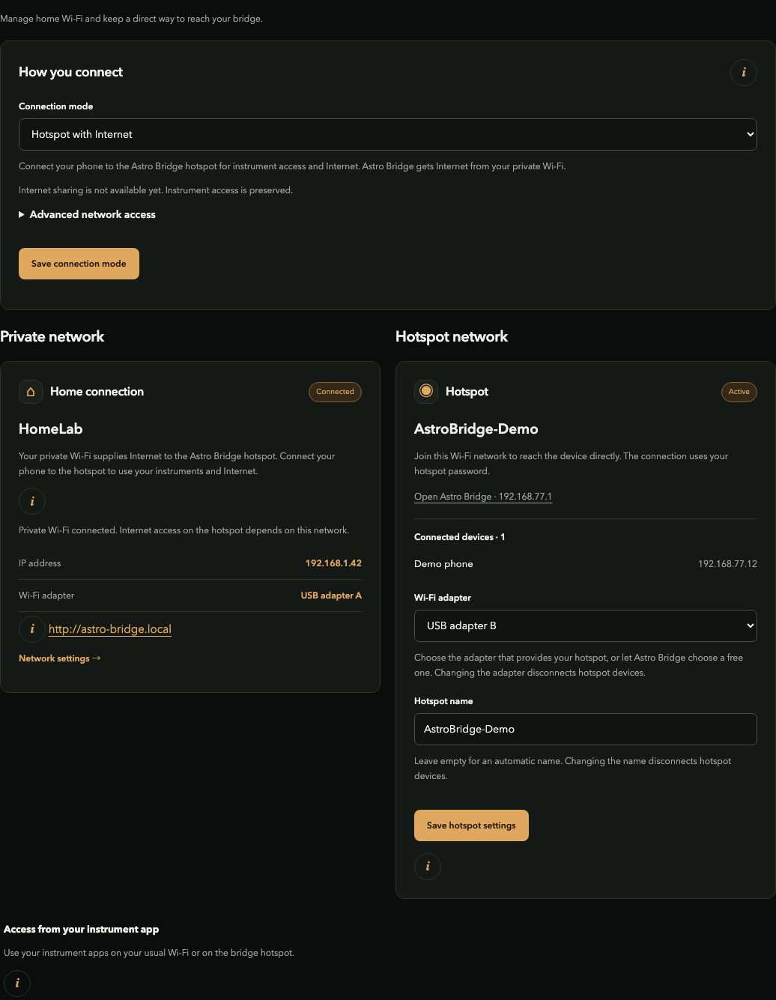

# Raspberry Pi Zero W

[Documentation](README.md) / Raspberry

The Raspberry download is a **complete Alpine Linux operating-system image** with Astro Bridge, drivers and system services already installed. Astro Bridge starts automatically as a service at boot; no separate Core installation is needed.

Flash the `.img.xz` to an SD card for the original Raspberry Pi Zero W. For an existing computer, compare [Core and Docker installation](deployment-options.md) instead.

## Hardware and network roles

Use an original Pi Zero W with a suitable SD card, power supply, hub and Linux-supported Wi-Fi adapters. The built-in radio can serve one role; add adapters for simultaneous private Wi-Fi, hotspot and telescope uplinks.



The implementation uses diskless Alpine, OpenRC and an **ASTRO_DATA** persistent partition. The core is staged from the exact locked wheel; drivers, services and recovery helpers belong to the image.

## Download and flash

Use the [native flasher](flasher.md), or download the release `.img.xz` and `ALPINE-STANDARD-SHA256SUMS` for Raspberry Pi Imager. Exact OS source archives and a package/recipe manifest accompany the image.

## Build a local SD image

```sh
python3 tools/core-artifact.py fetch
python3 tools/build-raspberry.py \
  --wheel build/core/astro_bridge_core-1.1.0-py3-none-any.whl \
  --stage build/pi-release --build
```

Use a new stage directory. The builder needs Docker, Internet and at least 8 GiB free. It uses a pinned base/aports commit, records package closure and checks the compressed image, boot files, application identity and partition geometry.

Output is under `build/pi-release/dist/standard-1.1.0/`. The builder checks geometry, filesystems, package signatures, firmware/modules and exact application identity. Fresh physical boot/radio acceptance is reported separately.

## Flash and first access

1. Verify the image against `ALPINE-STANDARD-SHA256SUMS`.
2. Use the staged flasher's help/inspection workflow and explicitly select the removable target. Flashing erases that target.
3. Keep the generated access information private. Boot the board and allow initial provisioning to finish.
4. Join the configured hotspot and open **http://192.168.77.1**.
5. Change initial access codes, select adapters, and follow the [Core setup guides](https://github.com/Sqound/astro-bridge-core/tree/main/doc).

The current image uses the documented initial code **12345678**; change web, hotspot and system-account credentials independently before normal use. Existing installations retain their credentials during an application update.

## Local console and SSH

No image contains a password or password hash: accounts receive the documented initial password `12345678` on the first boot, and every new password is kept on the data partition.

- **Raspberry Pi Zero W:** sign in as `bridge` (initial password `12345678`, administrator through `sudo`), on the HDMI console or by SSH. `root` is locked at every boot. Change the password from the web interface (Settings) or with `passwd`, then keep it with `sudo /usr/bin/python3 /usr/libexec/astro-bridge-persist save-password`.
- **Raspberry Pi 5:** the console administrator is `root` (initial password `12345678`; SSH is not enabled). Change it with `passwd`, then keep it with `rc-service astro-console-account save` (also done at a clean shutdown). If its saved state is unusable, `root` stays locked.

Change the initial password on the first sign-in, and keep the board physically secure: the local console is the recovery path.

## Upgrade an existing installation

An application-only OTA does **not** require reflashing. It preserves configuration and uses the separately installed OS updater for health checks and rollback. An upgrade from an existing 0.6.35 diskless installation to the locked 1.0.0 application was verified; that does not prove booting this newly assembled SD image.

See [updates and recovery](updates.md). OS, kernel, firmware or missing helper prerequisites require separate platform work.
