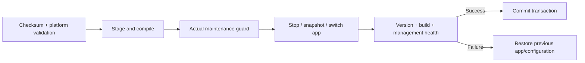

# Updates and recovery

[Documentation](README.md) / Updates

## Choose the correct update path

| Deployment | Update path |
| --- | --- |
| Raspberry appliance | Verified application-only OTA through the matching OS updater |
| Docker | Build the next locked image, stop the old container, recreate with persistent state retained |
| Native Linux | Stage a new verified app environment, update service configuration and retain private state |
| New OS/kernel/firmware | Separate platform maintenance or a validated SD image |

## Appliance transaction

The application must positively report safe maintenance: no connected/enabled instruments, protections, pending operations or conflicting maintenance. Staging is not permission to bypass a later guard. Never infer safety from low traffic alone.

The updater is installed separately so a broken application cannot remove its recovery path. A successful install requires repeated healthy responses matching the expected **version and build ID**. App-only OTA does not replace OS services, certificate helpers, drivers or the kernel.

## Preserve state

Back up configuration, certificates, push state and credentials privately before maintenance. After an update, verify the original network mode, hotspot adapter, native app paths, HTTPS identity and notification choices. Provider acceptance is not proof of phone display.

Do not migrate an existing update repository/channel implicitly. Release source, platform prerequisites and exact artifact checksums must be reviewed together.

## Recovery

Keep the previous application and transaction journal until the new service is verified. If recovery is required, use the installed platform updater's recovery procedure and logs. Do not delete the journal, forge health responses, flush all firewall rules or remove unrelated NM profiles.

A successful application restart is separate from a full power-cycle/fresh-image boot test.
