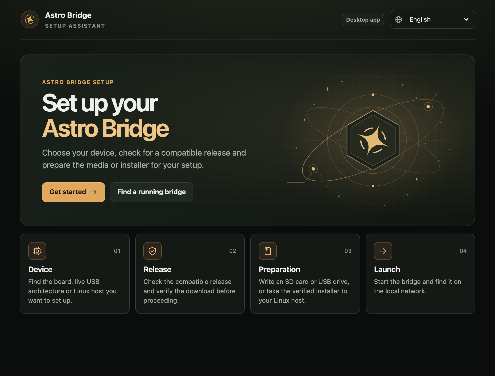
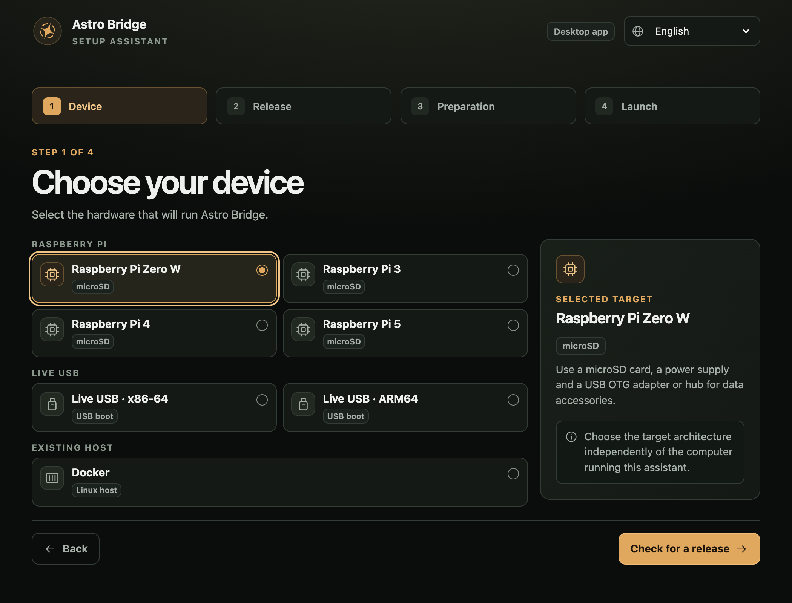
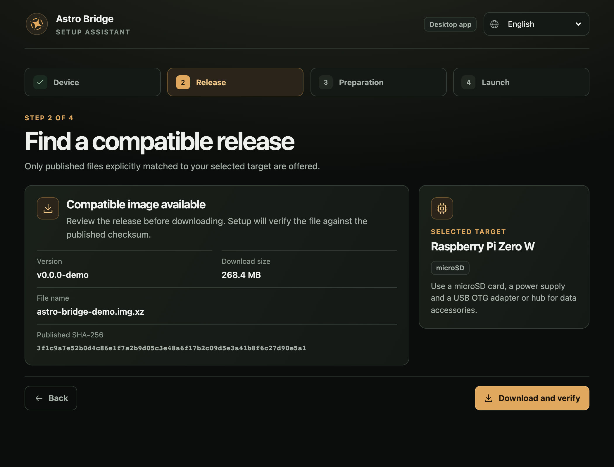
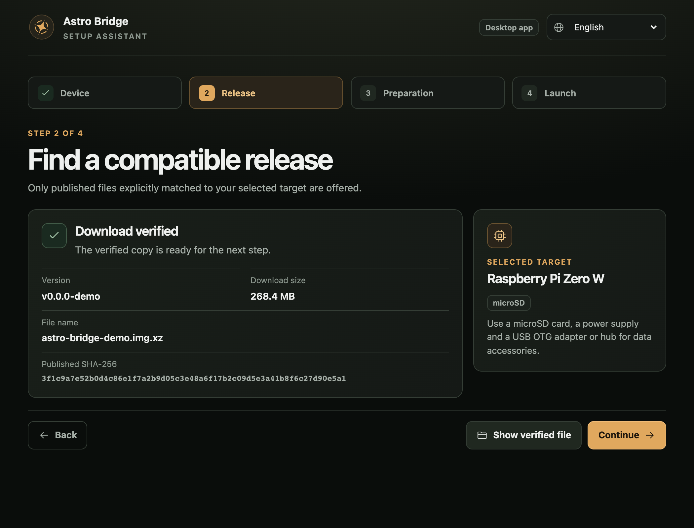
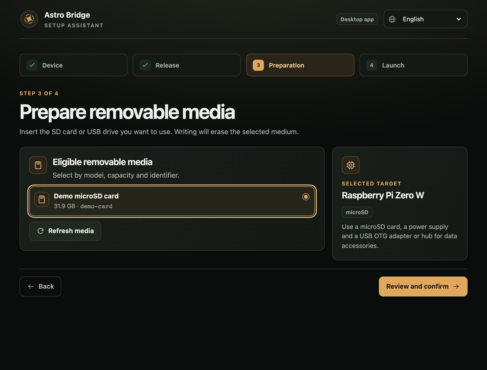
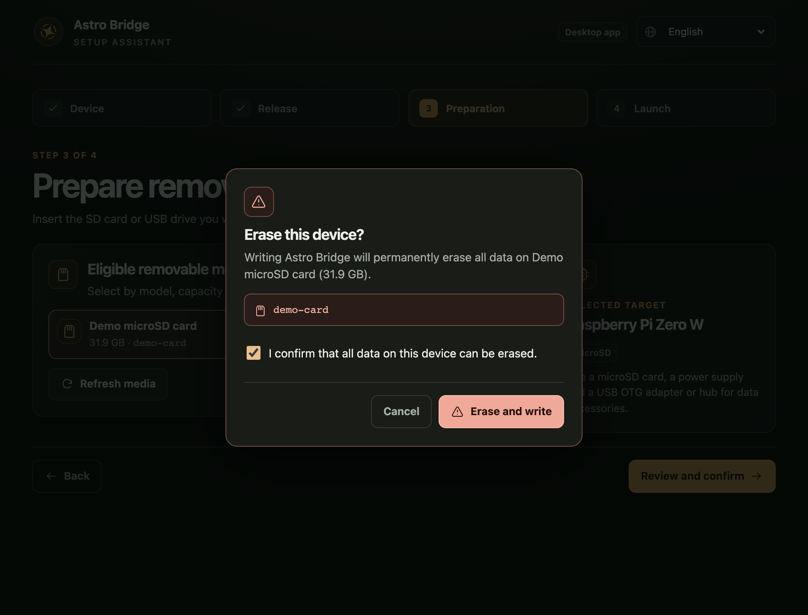
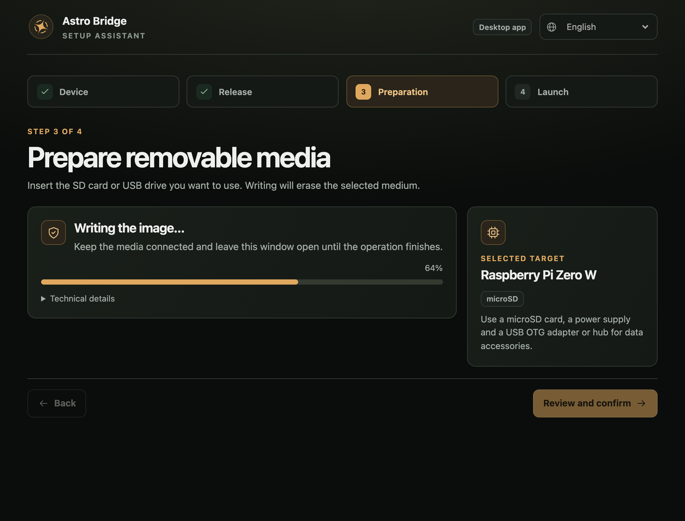
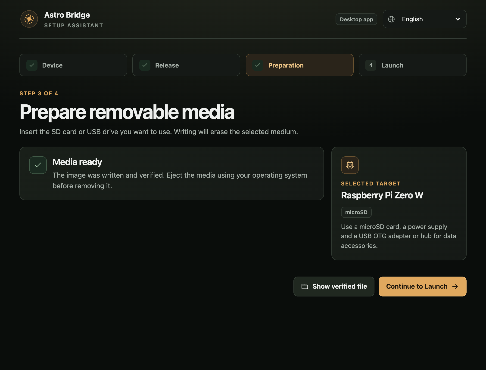
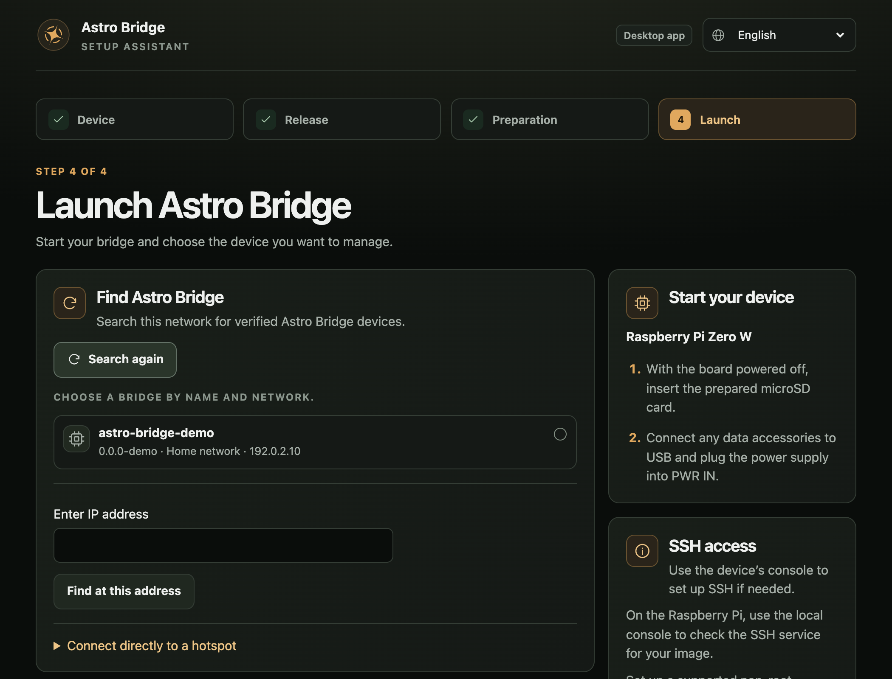

# Astro Bridge Setup

Astro Bridge Setup is a desktop assistant that prepares a device to run Astro Bridge and then finds the running bridge on your network. It is a [Tauri 2](https://tauri.app/) application: a Rust backend, a local HTML/JavaScript interface in ten languages, and a bundled helper built from [`raspberry/tools/astro-bridge-flasher.py`](../raspberry/tools/astro-bridge-flasher.py) that writes cards through the pinned, hash-verified Raspberry Pi Imager engine.

It guides you through four steps:

1. **Device** — choose a Raspberry Pi board, a live USB architecture or a Docker host.
2. **Release** — find a published release that explicitly lists your target, download it over HTTPS and verify its size and SHA-256.
3. **Preparation** — write and read back an SD card or USB drive after an explicit erase confirmation, or keep the verified Docker installer for your Linux host.
4. **Launch** — start the device, discover the bridge through its local DNS-SD announcement (or a local IPv4 address), check its API identity and open its web interface.



*Screens from the actual Setup interface with a synthetic backend: release, card and bridge names are demonstration values.*

## What it offers today

Setup has the same version as the implementations release it comes with. It only offers files that a published release explicitly matches to the selected target (`astro-bridge-setup-manifest.json`), plus two built-in entries for release 1.0.1 (the Raspberry Pi Zero W image and the Docker installer). Other targets show **No compatible release available** until a release lists them. Prereleases are skipped.

| Target | What Setup can do now |
| --- | --- |
| Raspberry Pi Zero W | Download, verify and write the 1.1.0 image |
| Raspberry Pi 5 | Download, verify and write the 1.1.0 image |
| Docker (Debian/Ubuntu host) | Download and verify `install-docker.sh`; it is never executed by Setup |
| Raspberry Pi 3, 4, live USB | Selection only: no published image yet |
| Any running bridge | Discover it on the local network or by IPv4 address and open its web interface |

## Install

Download the file for your system from the [latest implementations release](https://github.com/Sqound/astro-bridge-implementations/releases/latest) and check it against `SHA256SUMS`:

- **macOS (Apple silicon):** `Astro-Bridge-Setup_macos_arm64.dmg`, signed with a Developer ID and notarized. Open it and drag **Astro Bridge Setup** to Applications.
- **Windows x64:** `Astro-Bridge-Setup_windows_x64-setup.exe`, not signed: SmartScreen may warn; choose **More info**, then **Run anyway**.
- **Linux x64 (Ubuntu 22.04 or newer):** `Astro-Bridge-Setup_linux_x64.deb` (`sudo apt install ./Astro-Bridge-Setup_linux_x64.deb`) or `Astro-Bridge-Setup_linux_x64.AppImage` (`chmod +x`, then run it), not signed.

The Windows and Linux builds come from the manual `release-builds.yml` workflow and have not yet been checked on a real computer.

Writing a card asks your operating system for permission: on macOS, Raspberry Pi Imager requests authorization; on Linux, PolicyKit with an authentication agent is required; on Windows, an elevation prompt appears.

## Use it step by step

1. Open **Astro Bridge Setup** and select **Get started**. To manage a bridge that is already running, select **Find a running bridge** instead and go to step 6.
2. Choose your device, then **Check for a release**.
   
3. Review the version, size, file name and published SHA-256, then **Download and verify**. The verified copy stays in the application cache.
   
   
4. Insert the card, select it by model, capacity and identifier, then **Review and confirm**. Only removable media with a unique hardware identity are listed.
   
5. Tick the erase confirmation and select **Erase and write**. Keep the card connected and the window open while the image is written and read back.
   
   
   
6. **Continue to Launch**, start the device as shown, then **Search local network**. Choose the bridge by name and network, or enter its IPv4 address. For a direct hotspot connection, join the bridge's Wi-Fi in your operating system first, then use **Connect directly to a hotspot**.
   
7. Select **Open web interface** to continue in the Astro Bridge application.

For Docker, step 4 shows the verified installer: copy it to your dedicated Debian or Ubuntu host and follow the [Docker guide](../doc/docker.md).

## Build from source

Requirements: Rust, Node.js/npm, Python 3.13 and the native prerequisites of Tauri 2 (Xcode command-line tools on macOS; Microsoft C++ build tools and WebView2 on Windows; WebKitGTK and GTK on Linux). Choose an absolute, writable build directory outside the repository as `SETUP_BUILD_ROOT`, then run from the repository root:

```sh
mkdir -p "$SETUP_BUILD_ROOT"
export CARGO_HOME="$SETUP_BUILD_ROOT/cargo" CARGO_TARGET_DIR="$SETUP_BUILD_ROOT/target"
python3 -m venv "$SETUP_BUILD_ROOT/python"
"$SETUP_BUILD_ROOT/python/bin/python" -m pip install 'pyinstaller==6.16.0' 'pyinstaller-hooks-contrib==2026.9' 'certifi==2026.10.19'
"$SETUP_BUILD_ROOT/python/bin/python" -m PyInstaller --noconfirm --onefile --name astro-bridge-helper \
  --distpath setup/desktop/bin --workpath "$SETUP_BUILD_ROOT/helper-build" --specpath "$SETUP_BUILD_ROOT" \
  --collect-data certifi raspberry/tools/astro-bridge-flasher.py
cd setup/desktop
npm exec --yes --package @tauri-apps/cli@2.9.6 -- tauri build --bundles app   # macOS
# Windows: --bundles nsis (helper named astro-bridge-helper.exe); Linux: --bundles deb
```

The macOS bundle is written under `$CARGO_TARGET_DIR/release/bundle/macos/`. The helper is embedded; no system Python is needed to run it. Distribution builds additionally need platform signing (Developer ID and notarization on macOS, Authenticode on Windows).

## Signed macOS build (maintainers)

The macOS package is signed with a **Developer ID Application** certificate and notarized, following the same recipe as other projects of the team: Tauri signs and notarizes the `.app` when the four `APPLE_*` variables are set, and the `.dmg` is notarized and stapled by hand. The values come from the login keychain and the App Store Connect API key file kept outside the repository; they are never written in a file of the repository.

```sh
export APPLE_SIGNING_IDENTITY="Developer ID Application: <team name> (<team id>)"
export APPLE_API_KEY=<key id> APPLE_API_ISSUER=<issuer id> APPLE_API_KEY_PATH=<path to the .p8 file>
# 1. Helper signed with the hardened runtime before it is embedded (notarization rejects unsigned code in Resources).
"$SETUP_BUILD_ROOT/python/bin/python" -m PyInstaller --noconfirm --onefile --name astro-bridge-helper \
  --distpath setup/desktop/bin --workpath "$SETUP_BUILD_ROOT/helper-build" --specpath "$SETUP_BUILD_ROOT" \
  --collect-data certifi --codesign-identity "$APPLE_SIGNING_IDENTITY" raspberry/tools/astro-bridge-flasher.py
codesign --force --options runtime --timestamp --sign "$APPLE_SIGNING_IDENTITY" setup/desktop/bin/astro-bridge-helper
setup/desktop/bin/astro-bridge-helper --help >/dev/null   # the signed helper still starts
# 2. App signed and notarized by Tauri, .dmg signed by Tauri.
(cd setup/desktop && npm exec --yes --package @tauri-apps/cli@2.9.6 -- tauri build --bundles app,dmg)
dmg="$(find "$CARGO_TARGET_DIR/release/bundle/dmg" -name '*.dmg' -print -quit)"
# 3. The .dmg notarized and stapled, then checked.
xcrun notarytool submit "$dmg" --key "$APPLE_API_KEY_PATH" --key-id "$APPLE_API_KEY" --issuer "$APPLE_API_ISSUER" --wait
xcrun stapler staple "$dmg" && xcrun stapler validate "$dmg"
spctl -a -vv -t install "$dmg"          # accepted, source=Notarized Developer ID
cp "$dmg" Astro-Bridge-Setup_macos_arm64.dmg && shasum -a 256 Astro-Bridge-Setup_macos_arm64.dmg
```

## Tests

```sh
(cd raspberry && python3 -m unittest tests.test_flasher)
cargo test --locked --manifest-path setup/desktop/Cargo.toml
cargo test --locked --manifest-path setup/catalog/Cargo.toml
node setup/tests/setup-wifi-browser.mjs
node setup/tests/setup-launch-ip-browser.mjs
node setup/tests/setup-first-boot-browser.mjs
node setup/tests/setup-launch-browser.mjs
node setup/tests/setup-flash-phases-browser.mjs
```

The Tauri build script requires a file under `setup/desktop/bin/` (the helper built above; any placeholder is enough for `cargo test`). Tests use fixtures, mocked disks and a synthetic browser backend. They never download Imager, list real disks or write media.

## Safety and limits

- A card must have a unique hardware identity. The helper checks its complete metadata before writing and, on Windows and Linux, again after elevation. On macOS the worker revalidates immediately before Imager starts but cannot revalidate after Imager's own authorization prompt.
- The Imager engine is derived from a pinned vendor asset whose SHA-256 is checked before every launch (Windows: pinned installer signature and version).
- GitHub and its release-asset hosts are the only download destinations. Downloads time out when stalled; integrity failures stop the flow.
- Closing the window is blocked while an operation runs, but forced termination or power loss can still interrupt a write. Inspect the result and re-write if needed.
- Discovery uses the `_astrobridge._tcp` DNS-SD service; macOS asks for local-network permission the first time.

A verified write is not evidence that a board boots or that hardware works: see the [validation matrix](../doc/reference/validation.md).
